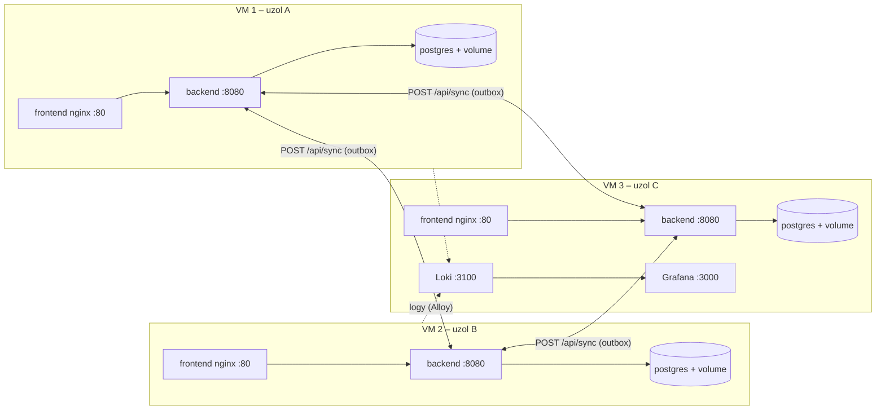

# Dunaj Express – uzol C (Centrála, VM 3)

Vetva `node-c` distribuovaného IS Dunaj Express (Variant 2). Obsah vetvy sa nasadzuje na jednu VM.

| | |
|---|---|
| Uzol | C |
| Rola (`NODE_ROLE`) | `OFFICE` |
| Frontend | `Office` |
| Vetvy ostatných uzlov | `node-a`, `node-b` |

Backend je rovnaký vo všetkých vetvách, líši sa len frontend a `NODE_ID` / `NODE_ROLE` / `PEERS` v `docker-compose.yml` a `.env`.

## Architektúra



Každý uzol žije vo vlastnej git vetve (`node-a`, `node-b`, `node-c`) s vlastným frontendom, spoločným (identickým) backendom, Dockerfile-mi, `docker-compose.yml` a `.env.example`. Obsah vetvy = jeden uzol = jedna VM:

| Kontajner | Obraz | Poznámka |
|---|---|---|
| `db` | `postgres:17-alpine` | vlastná DB uzla, named volume `pgdata` |
| `backend` | `backend/Dockerfile` (kód rovnaký vo všetkých vetvách) | líši sa len `NODE_ID`, `NODE_ROLE`, `PEERS` |
| `frontend` | `frontend/Dockerfile` (A = Point, B = Depot, C = Office) | nginx, `/api` preposiela na `backend` (žiadne CORS) |
| `log-agent` | `grafana/alloy` | posiela logy kontajnerov do Loki na uzle C |
| `loki`, `grafana` | len uzol C | súčasť `docker-compose.yml` uzla C |

### Synchronizácia
1. Zápis do lokálnej DB a riadky v `outbox` (jeden na každého peera) sa robia v **jednej transakcii**.
2. `SyncWorker` každých 5 s posiela `outbox` peerom (`POST /api/sync`, hlavička `X-Sync-Token`). Riadok sa zmaže až po úspešnom odoslaní, takže neodoslané operácie prežijú aj reštart (outbox je v DB na volume).
3. Poradie operácií sa zachováva (ak peer zlyhá, ďalšie operácie pre neho sa v danom kole nepošlú).
4. **Idempotencia**: každá operácia má `eventId`; príjemca si ho ukladá do `processed_events` v tej istej transakcii ako zmenu, opakovaný event sa ignoruje. Navyše: upsert podľa UUID, `updated_at` (starší update neprepíše novší), tombstone `deleted_parcels` (oneskorený CREATE/UPDATE nevzkriesi zmazanú zásielku).

## Nasadenie (VM 3)

Na VM: Docker + Docker Compose v2, sieť **bridged** (porty 80, 8080, 3000, 3100).

```bash
git clone -b node-c --single-branch https://github.com/SmallFlatty/Distribuovan-technol-gie-I-Demo-app-.git dt
cd dt
cp .env.example .env
nano .env                         # IP adresy ostatných VM, SYNC_TOKEN (rovnaký na všetkých), heslá
docker compose up -d --build
docker compose ps                 # všetky služby majú byť healthy
```

Bez gitu: skopíruj na VM obsah vetvy (`scp -r node-c user@<ip>:~`).

Adresy: frontend `http://<ip-vm>/`, stav uzla `http://<ip-vm>:8080/api/status`, health `http://<ip-vm>:8080/actuator/health`, Grafana `http://<ip-vm>:3000`.

> `.env` nepatrí do repozitára (je v `.gitignore`), len `.env.example`.

## Stavový panel
Pod hlavičkou každého frontendu je panel „Stav uzlov“ (obnova každé 3 s, zdroj `GET /api/status`): tento uzol (DB, počet neodoslaných operácií, uptime) a obaja susedia (online/nedostupný, posledný kontakt, posledná synchronizácia, koľko operácií na nich čaká v outboxe, posledná chyba).

## Demo scenáre

**1. Online replikácia** – na uzle A vytvor zásielku, do ~5 s je na B aj C (`/api/parcels`). Na B zmeň stav, na C pošli notifikáciu.

**2. Odpojenie uzla a lokálna práca**
```bash
# na VM, ktorú chceš odpojiť
./scripts/isolate-node.sh
```
Alternatíva: vypni sieťový adaptér VM v hypervisore. Backend, DB a lokálny frontend bežia ďalej, pracuj normálne (na A vytvor/zruš zásielky, na B zmeň stav). V paneli ostatných uzlov je B „nedostupný“, v paneli odpojeného uzla rastie „Čaká na odoslanie“. Potom:
```bash
./scripts/rejoin-node.sh
```
Do niekoľkých sekúnd sa `outbox` vyprázdni a dáta sú na všetkých uzloch rovnaké (v logoch `SYNC RECOVERED`, `SYNC OK`).

**3. Perzistencia po reštarte** – `docker compose restart` alebo `docker compose down` + `docker compose up -d` (dáta aj outbox ostanú; `down -v` volume zmaže!).

**4. Idempotencia** – ten istý `POST /api/sync` (rovnaký `eventId`) pošli dvakrát; druhý raz sa v logu objaví `SYNC duplicate event … ignored` a dáta sa nezmenia.

## Health checks, logy, nasadenie
- **Health checks**: Spring Boot Actuator (`/actuator/health`, vrátane DB) + `HEALTHCHECK`/`healthcheck:` pre `db`, `backend`, `frontend`; `restart: unless-stopped`.
- **Centralizované logovanie**: backend loguje cez SLF4J do stdout (kód uzla v každom riadku), `log-agent` (Grafana Alloy) posiela logy všetkých kontajnerov do Loki na uzle C. Grafana dashboard „Dunaj Express – logy“ je predpripravený (filter podľa uzla, riadky `SYNC` / `PEER` / `OUTBOX`).
- **Automatické nasadenie**: každá VM raz za 2 minúty kontroluje git; ak je nová verzia, stiahne ju a prebuilduje svoj stack (`scripts/auto-deploy.sh`):
  ```bash
  # crontab -e
  */2 * * * * /home/<user>/dt/scripts/auto-deploy.sh >> /var/log/dt-deploy.log 2>&1
  ```
- **CI** (`.github/workflows/ci.yml`): po pushi do vetvy type-check frontendu, validácia compose súboru a test build obrazov.

## Lokálny vývoj (bez Dockeru)
Backend (`backend/`) číta konfiguráciu z prostredia, nastav v run konfigurácii IDE:
`NODE_ID`, `NODE_ROLE`, `PEERS`, `DB_URL`, `DB_USER`, `DB_PASSWORD`, `SYNC_TOKEN` (premenné majú predvolené hodnoty len pre uzol A na localhost, tajomstvá nie). Frontend: `npm run dev` v `frontend/` (adresu API určuje `.env`).

## Obmedzenia
- Komunikácia medzi uzlami je HTTP chránené zdieľaným tokenom (bez TLS); pre produkciu by sa pridalo TLS/VPN.
- Konflikty sa riešia pravidlom jediného zapisovateľa (A: create/delete, B: update, C: notifikácie) a last-write-wins podľa `updated_at`.
